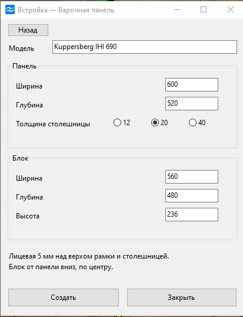
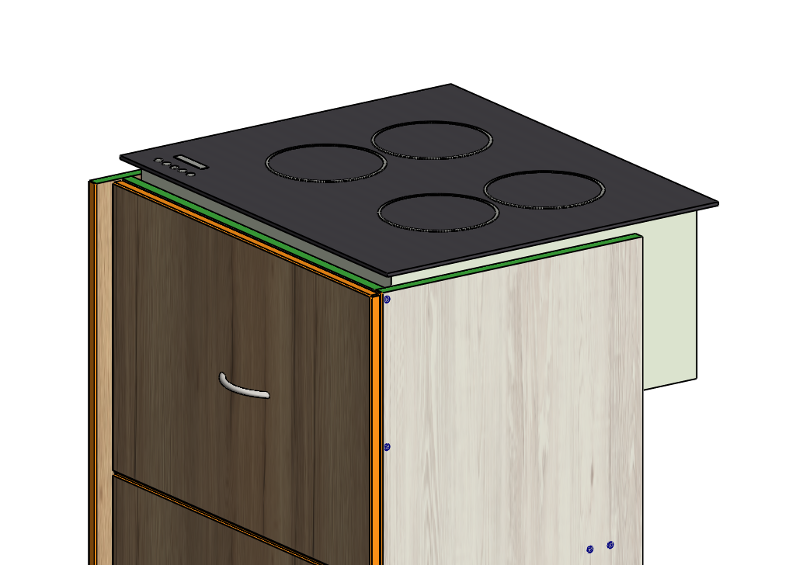
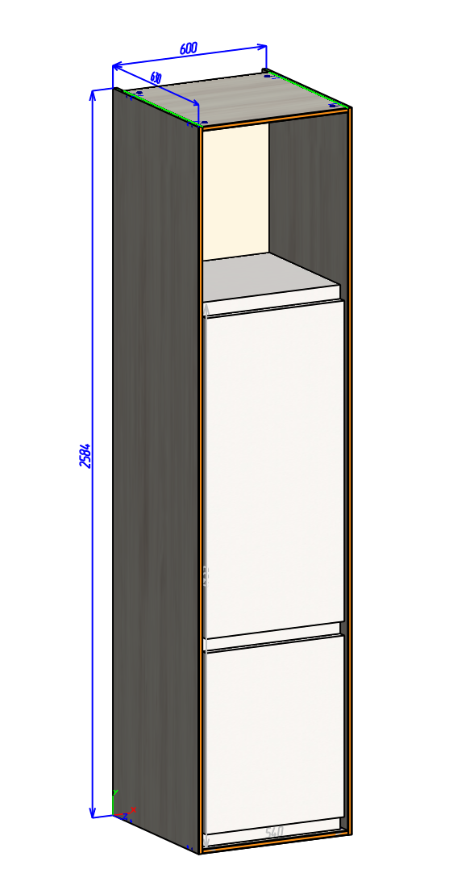
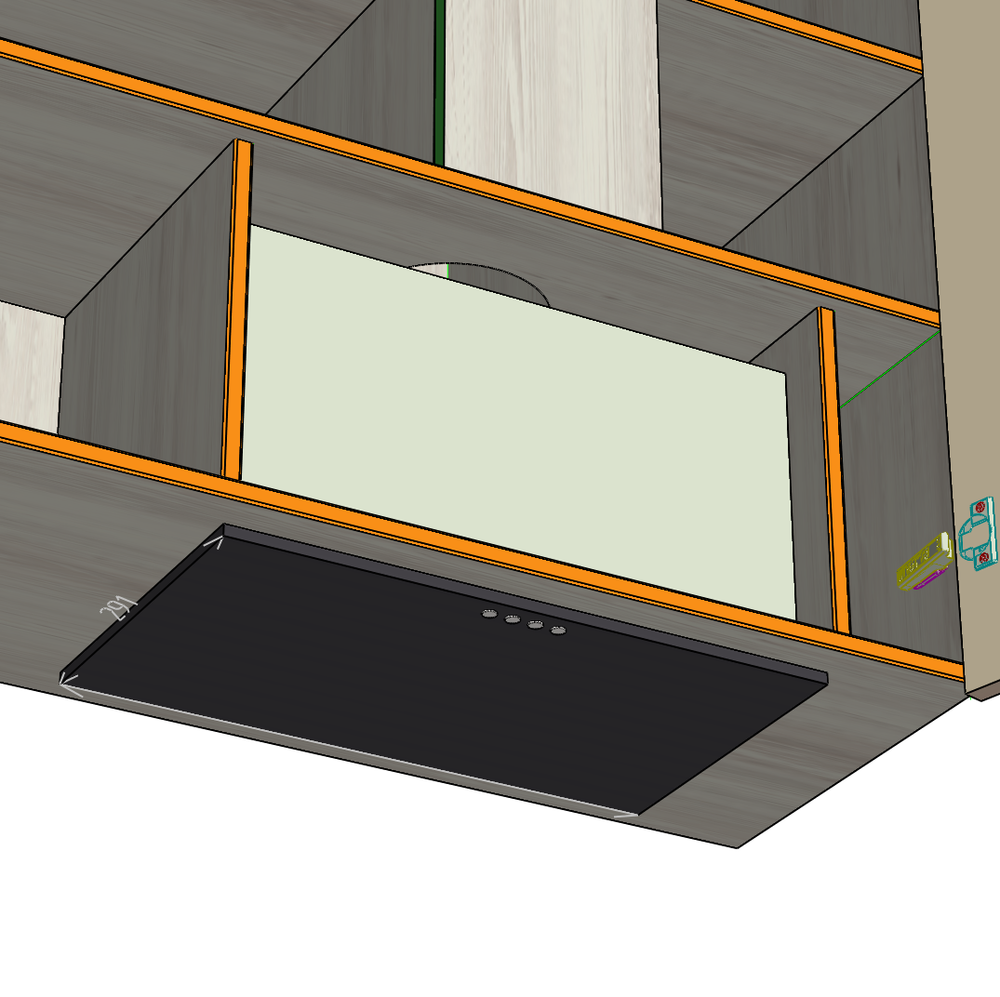
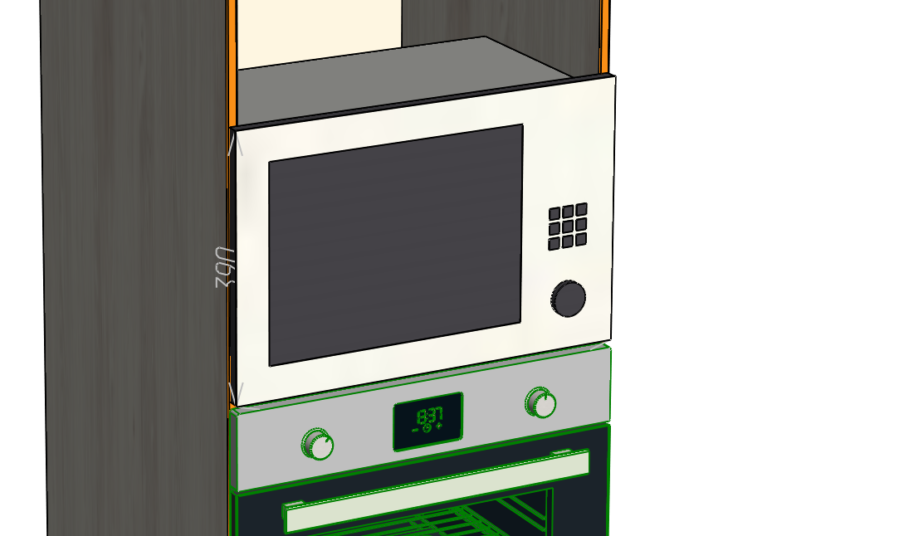

# Встройка

Ставит в модель примитивную технику по заданным габаритам для улучшения визуализации. На данный момент доступна встройка СВЧ, холодильника, варочной и вытяжки.

Для каждого типа несколько настраиваемых параметров.

Позиционирует по габаритной рамке.

Материалы можно заменить в начале скрипта

Сборка: Базис 2024.11.14.0, редактор скриптов v20.

